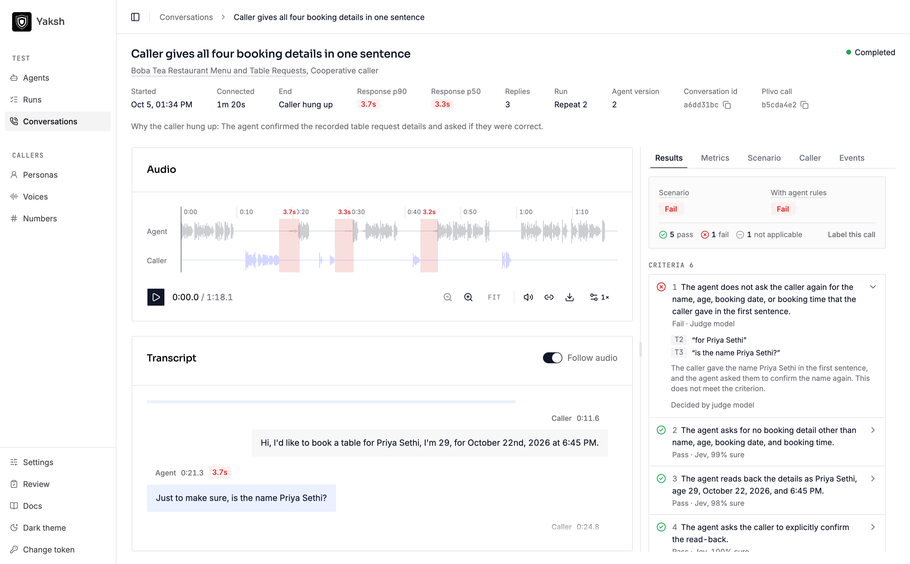

# Yaksh

**Find out how your voice agent behaves on real calls before your customers do.**

Yaksh calls your AI voice agent over a real phone line, plays a realistic caller, and tells you what went wrong, with the transcript line that proves it. Open source, self-hosted, and free. By [Plivo](https://plivo.com).



## Why Yaksh

Most teams test a voice agent by calling it themselves a few times before each release. That catches the obvious bugs. It does not catch the agent that forgets to confirm a booking one call in five, talks over a caller in a noisy street, or makes people wait four seconds after a hard question.

Yaksh runs those calls for you, in volume, every time you change your agent.

- **Real phone calls, not text.** Yaksh dials your agent's number through Plivo, so it tests what your customers hear: speech recognition, latency, interruptions and hang-ups.
- **Callers that act like people.** Personas with their own voice, language and background noise: a cafe, a car, a TV, a second person in the room.
- **Verdicts you can trust.** Judges check each call against your criteria and quote the transcript, and code checks every quote. When the simulated caller makes a mistake, Yaksh marks the test as blocked, and does not blame your agent.
- **Numbers that mean something.** Pass rate, the chance that a scenario passes twice in a row, response time p50 and p90, talk-overs and dead air, each with a confidence interval, so a run of five calls does not look like proof.
- **Built for coding agents.** The CLI lets Claude Code, Codex and other coding agents run your tests, read why calls failed, fix your agent and test again, all in one loop.
- **Your data stays yours.** You run Yaksh on your own servers with your own provider accounts. Recordings, transcripts and results stay in your own database and storage.

## Works with your agent

Yaksh tests any agent with a phone number: agents that answer calls and agents that place them. Import an agent from **Plivo CX, Vapi, Retell or ElevenLabs** in one step, or describe it by hand. Callers speak English (US, UK, India, Australia), Spanish, Hindi, Bengali, Gujarati, Kannada, Marathi, Tamil and Telugu.

## How it works

1. **Add your agent.** Import it, or give its number and what it does.
2. **Write scenarios.** Write them yourself, or let Yaksh write them from your agent's brief, configuration and knowledge base.
3. **Run.** Yaksh places the calls, records them and judges them.
4. **Read the results.** Each failed call shows the criterion it broke and the lines that prove it. Listen to the recording, or to a call while it is live.

## Quick start

You need Docker, a Plivo account with a phone number, and API keys for an LLM provider (OpenAI or Azure OpenAI), Deepgram and ElevenLabs.

```sh
git clone https://github.com/plivo-labs/yaksh && cd yaksh
cp docker/.env.example docker/.env   # set YAKSH_API_TOKEN and YAKSH_ENCRYPTION_KEY
docker compose -f docker/compose.yaml up
```

1. Open http://localhost:8000 and enter your API token.
2. On the Settings page, add your provider keys and Plivo credentials.
3. Give Plivo a public HTTPS address for the worker. For local tests, run `scripts/tunnel.sh` and put the `YAKSH_PUBLIC_URL` line it prints in `docker/.env`.
4. Add your agent, add a scenario, and start a run.

To install Yaksh on a server, see [Self-hosting](docs/content/docs/self-hosting.mdx).

## Test from your coding agent

Install the CLI:

```sh
curl -fsSL https://raw.githubusercontent.com/plivo-labs/yaksh/main/install.sh | bash
export PATH="$HOME/.yaksh/bin:$PATH"
yaksh auth login --server http://localhost:8000
```

The CLI keeps itself at the version of your server. See [Versions and upgrades](docs/content/docs/versions.mdx).

Then add the skill to your coding agent with `npx skills add plivo-labs/yaksh`, and ask it to test your voice agent.

## Docs

- [Quick start](docs/content/docs/quickstart.mdx)
- [Configuration](docs/content/docs/configuration.mdx)
- [Writing instructions](docs/content/docs/writing-instructions.mdx) and [criteria](docs/content/docs/writing-criteria.mdx)
- [Runs](docs/content/docs/runs.mdx) and [Results](docs/content/docs/results.mdx)
- [Judges](docs/content/docs/judges.mdx)
- [Outbound agents](docs/content/docs/outbound-agents.mdx)
- [CLI](docs/content/docs/cli.mdx)
- [Troubleshooting](docs/content/docs/troubleshooting.mdx)

## Develop

```sh
docker compose -f docker/compose.dev.yaml up --build
```

Open http://localhost:5173. See [Development](docs/content/docs/development.mdx) for more.

## License

[BSD 2-Clause](LICENSE)
